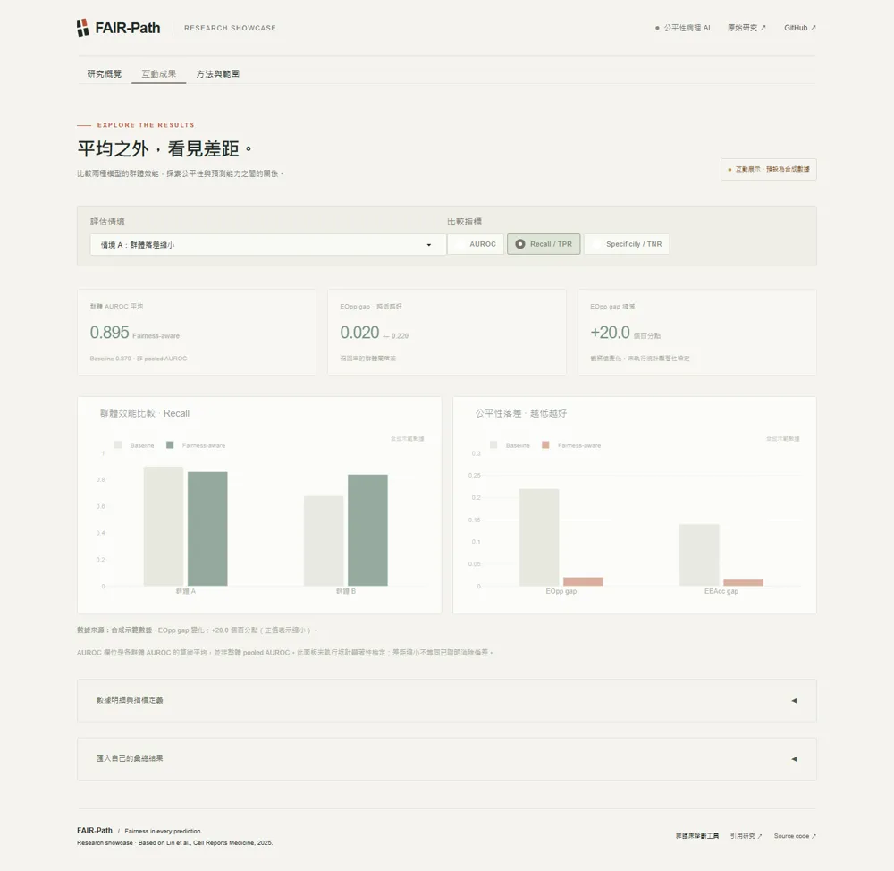

<div align="center">

# Fairness-aware Contrastive Learning
### 公平性數位病理 AI · 專案成果展示

以 GitHub Pages 靜態網站呈現研究背景、公開成果與群體效能比較，並保留本機 Gradio 版本。


[公開成果展示](https://keithwu1017.github.io/fairness-aware-contrastive-learning/) · [研究來源](https://github.com/hms-dbmi/fairpath) · [部署說明](docs/DEPLOYMENT.md) · [資料格式](docs/DATA_FORMAT.md)

</div>

## 專案介紹

病理 AI 的平均效能可能掩蓋人口群體間的落差。本專案基於 FAIR-Path 研究，建立易於展示與操作的繁體中文前端，說明公平性感知對比學習的目的，並以群體比較圖表呈現效能與公平性的關係。

**這是獨立實作的成果展示層。** 儲存庫僅提供前端、圖表及彙總資料處理；不包含核心訓練、損失函數、模型權重或患者影像。本版未串接模型推論，啟動不需 GPU。

## 原研究公開成果

| 項目 | 原研究 README 摘要 |
| --- | --- |
| 泛癌種評估範圍 | 20 種癌症 |
| 觀察到的差異緩解 | 88.5% |
| 獨立外部驗證 | 15 個世代 |
| 外部差距縮減 | 91.1% |

來源：[hms-dbmi/fairpath / Overview](https://github.com/hms-dbmi/fairpath#overview)，查核日期 2026-11-17。這些是**原作者公開研究成果**，並非本專案重新驗證或自有模型實驗。百分比不是診斷準確率，其分母與統計定義請參閱原論文。本專案未取得個別任務的原始結果或預訓練權重。

## 展示功能




- **專案概覽**：問題背景、研究成果卡片與來源。
- **互動比較**：切換兩種合成情境，比較 Baseline / Fairness-aware 的 AUROC、TPR、TNR。
- **公平性面板**：顯示 EOpp gap、EBAcc gap 與群體 AUROC 平均。
- **自有結果匯入**：依固定 CSV 格式載入群體彙總資料，顯示來源標籤。
- **方法說明**：保留高階概念與成果邊界，省略核心技術實作。

預設資料為**人工合成**，不是病理模型推論，也不對應真實癌種或患者。情境 A 示意群體差距縮小；情境 B 示意公平性改善時可能存在效能取捨。介面不會依影像或人口屬性產生虛構診斷。

## 公開網站

開啟 [FAIR-Path 成果展示](https://keithwu1017.github.io/fairness-aware-contrastive-learning/)，不需安裝 Python、登入 GitHub 或啟動本機伺服器。`site/` 中的 HTML、CSS、JavaScript 與合成資料透過 GitHub Pages 發布。

圖表與 CSV 匯入均在瀏覽器執行；匯入檔案不會傳送至伺服器或 GitHub。重新整理頁面後恢復預設合成資料。公開版與 Gradio 版共用示範資料格式及指標定義。

本機預覽靜態版：

```bash
python -m http.server 8000 --directory site
```

開啟 <http://localhost:8000>。不需安裝 `requirements.txt`。

## 本機 Gradio 版（可選）

使用 Python 3.11：

```bash
git clone https://github.com/Keithwu1017/fairness-aware-contrastive-learning.git
cd fairness-aware-contrastive-learning
python -m venv .venv
```

Windows PowerShell：

```powershell
.\.venv\Scripts\Activate.ps1
```

macOS / Linux：

```bash
source .venv/bin/activate
```

安裝與啟動：

```bash
python -m pip install -r requirements.txt
python app.py
```

開啟 <http://127.0.0.1:7860>。預設僅綁定本機，`share=False`。

## 展示導覽（約 3 分鐘）

1. 「研究概覽」介紹公平性問題與原研究成果。
2. 「互動成果」切換 Recall，觀察兩模型的群體差距。
3. 切至情境 B，再看 AUROC，說明公平性與效能需要共同評估。
4. 展開指標定義；需要時匯入已授權的自有彙總結果。
5. 「方法與範圍」說明前端與核心研究系統的分工。

## 專案結構

```text
site/                  GitHub Pages 公開網站（不需後端）
  index.html           成果介紹與展示頁面
  app.mjs              瀏覽器圖表、CSV 解析及指標計算
  style.css            靜態網站版面與響應式控制
  shared.css           共用展示視覺樣式
  data/                公開合成示範資料
app.py                 應用程式啟動入口
showcase.py            Gradio 介面與互動流程
presentation.py        研究展示內容與概念圖
ui.css                 視覺設計與響應式版面
resize.js              隱藏頁籤圖表的響應式尺寸修正
metrics.py             CSV 驗證、展示指標與圖表
data/demo_metrics.csv  明確標示的合成示範資料
docs/                  方法、資料格式與部署說明
tests/                 彙總指標與輸入驗證測試
Dockerfile             CPU 展示容器
requirements.txt       固定展示依賴版本
```

本展示以各群體 AUROC 算術平均呈現摘要，**不能作為整體 pooled AUROC**。不執行顯著性檢定或信賴區間估計；gap 縮小不等同統計上已證明消除偏差。非臨床診斷工具。

## 驗證

```bash
node --test tests/static.test.mjs
python -m unittest discover -s tests -v
```

GitHub Actions 檢查瀏覽器版指標、CSV 驗證及 Gradio UI 建立。`Deploy public showcase` 工作流程只發布 `site/`，不包含 Python 程式與研究核心實作。部署方式見 [說明](docs/DEPLOYMENT.md)。

## 致謝與授權

研究概念與成果歸原作者所有：Lin, Shih-Yen; Tsai, Pei-Chen; Su, Fang-Yi; et al. (2025). *Contrastive learning enhances fairness in pathology artificial intelligence systems*. Cell Reports Medicine, 6(12)。完整作者資訊與引用格式見 [原始儲存庫](https://github.com/hms-dbmi/fairpath#citation)。本展示不表示獲原作者或機構背書。

展示程式採 [AGPL-3.0](LICENSE)。未複製原專案的訓練或推論程式；原研究程式另依其原有授權條件提供。
